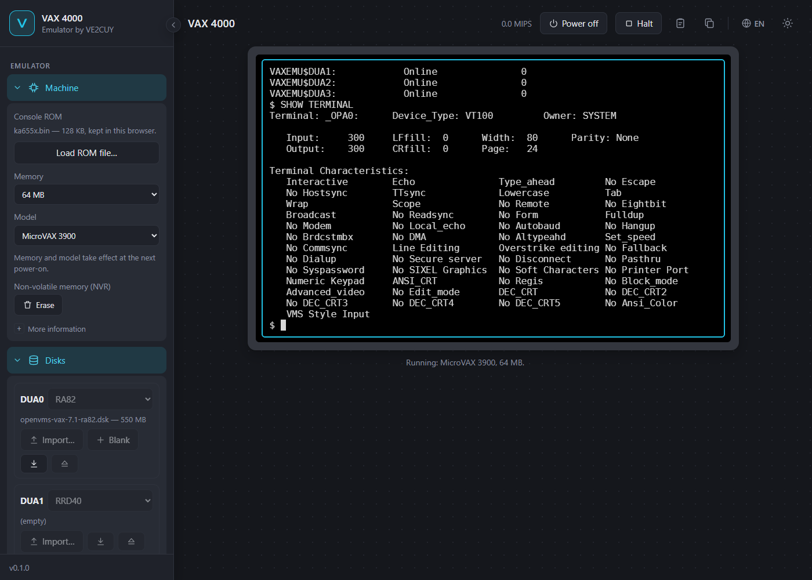

# VAX 4000 emulator

A VAX emulator that runs in your web browser, written in Rust and compiled to
WebAssembly. It installs and runs **OpenVMS VAX**, as on a VAX 4000 model 200.

**Try it: <https://ve2cuy.github.io/vax-emu/>** · [Version française](README_FR.md)



## Status

- **Processor**: complete CVAX instruction set (integer, F/D/G floating point, strings,
  queues, memory management, exceptions and interrupts). It passes DEC's *Hardware Core
  Instruction* diagnostic (EHKAA).
- **Machine**: KA655 (MicroVAX 3900 / VAXserver 3900) — memory up to 512 MB, console
  serial line, timers, time-of-year clock, Qbus adapter.
- **Disks**: MSCP controller with four drives (DUA0-DUA3): RA disks and an RRD40 CD-ROM.
  **OpenVMS VAX V7.1 installs from its CD**, boots and accepts logins.
- **Network**: DELQA Ethernet controller (XQA0) on a private virtual network.
  **CMU-OpenVMS/IP** (TCP/IP) installs and runs.
- **Telnet**: a second terminal in the page opens telnet sessions into the VAX.
- **Coming next**: the VAX 4000-200 identity (KA660).

## Getting started

1. Open the emulator. The KA655 console ROM ([`ka655x.bin`](https://github.com/simh/simh/raw/master/VAX/ka655x.bin),
   from the [SIMH](https://github.com/simh/simh) project) is downloaded automatically
   the first time; you can also load your own copy in **Machine › Load ROM file…**.
   It stays in your browser and is never uploaded.
2. The self-tests count down from 40 to 03, then the console prompt `>>>` appears. Click
   the terminal and type, for example `SHOW DEVICE`, `SHOW MEMORY` or `HELP`.

The **Halt** button (or Ctrl+P, when the console allows it) stops the processor and
returns to the `>>>` prompt, like the BREAK key of a real console terminal.

Normally the VAX runs in real time, like the real machine, about 10 MIPS. The **Turbo**
button lets it run as fast as your browser allows while it is working (computing, disk
transfers, console output): OpenVMS boots in about 9 seconds instead of 23. While the VAX
waits, at a prompt for example, it keeps real time, so nothing times out faster; the
OpenVMS clock only gains a little during the bursts.

## Repository and one-click installs

The **Repository** menu lists the files of the emulator's repository
(<https://ve2cuy.com/vax>): console ROMs, ready-to-boot disks (OpenVMS VAX V7.1 installed,
with or without TCP/IP) and CDs (OpenVMS VAX V7.1, CMU-OpenVMS/IP, OpenVMS Freeware V2.0
and V3.0). Pick a file, choose a drive and press **Insert**: it is copied into your
browser (compressed files are decompressed on the way).

The **Install** menu automates the long parts:

- **Init from Web** puts a blank RA82 in DUA0 and the OpenVMS VAX V7.1 CD in DUA1, boots
  the CD, restores the system to the disk and starts the installation procedure; you then
  answer its questions (options, passwords, node name, time zone).
- **Install TCP/IP** installs CMU-OpenVMS/IP on the OpenVMS system in DUA0 (you give the
  SYSTEM password): telnet and FTP, address 10.0.2.15, started with the system. It also
  installs the `NETCONFIG` command, which changes the address, mask, gateway and DNS
  servers interactively (in English or French), restarts the network and tests it.

## Network

The **Network** menu chooses how the VAX's Ethernet controller (XQA0) is connected:

- **Virtual** (default): a private network where a gateway at 10.0.2.2 answers; give the
  VAX the address 10.0.2.15.
- **Local bridge**: the VAX appears on your local network with its own address (set in
  OpenVMS, e.g. 192.168.2.77), through the small *vax-bridge* relay running on your
  computer (Windows, Linux or macOS). Other computers can then ping it and open telnet
  sessions. See [Setting up the local bridge](#setting-up-the-local-bridge) below.

The toolbar's book icon opens an **OpenVMS cheat sheet**: basic DCL commands, important
directories, and how to change the TCP/IP address, gateway or name servers.

Above the screen, the **Telnet** tab opens a telnet session into the VAX in a second
terminal, next to the console: several logins at once, as on a real system. TCP/IP must be
running in OpenVMS (the Install TCP/IP button, or the repository's OpenVMS + TCP/IP disk).

On a phone or a tablet, a row of keys appears under the screen: Ctrl (tap it, then a
letter: Ctrl then Z sends Ctrl+Z), Esc, Tab, Ctrl+C, Ctrl+Y, Ctrl+Z, the arrows and
PF1-PF4. The Keyboard section shows or hides it on any device. A `.gz` image downloaded
from the repository can be imported as is: the page decompresses it.

## Setting up the local bridge

The *vax-bridge* relay runs on the computer where the browser is. It copies Ethernet
frames between the page and one of your network cards, so the VAX sits on your local
network with its own address. A wired card works best: many Wi-Fi cards and access points
drop frames from a second station address.

### 1. Install the relay

Download the file for your system from the
[Releases](https://github.com/ve2cuy/vax-emu/releases) page.

**Windows**

1. Install [Npcap](https://npcap.com) (default options).
2. Download `vax-bridge.exe`.
3. Find your PC's address with `ipconfig`, then, in a terminal:

   ```
   vax-bridge --iface 192.168.2.11
   ```

**Linux** (x86_64)

1. Install libpcap: `sudo apt install libpcap0.8` (Debian, Ubuntu), `sudo dnf install
   libpcap` (Fedora).
2. Unpack the relay: `tar xzf vax-bridge-linux-x86_64.tar.gz`
3. Start it on your network card (`ip addr` lists them):

   ```
   sudo ./vax-bridge --iface eth0
   ```

   To run it without `sudo`, give it the right to capture once:
   `sudo setcap cap_net_raw,cap_net_admin=eip vax-bridge`

**macOS** (`macos-arm64` for Apple Silicon, `macos-x86_64` for Intel)

1. Unpack the relay: `tar xzf vax-bridge-macos-arm64.tar.gz`
2. The program is not signed. If macOS refuses to start it:
   `xattr -d com.apple.quarantine vax-bridge`
3. Start it on your network card (`ifconfig` lists them; libpcap comes with macOS):

   ```
   sudo ./vax-bridge --iface en0
   ```

   The macOS builds have not been tried on a real Mac yet; reports are welcome.

On every system, `--iface` takes the card's name, your computer's IPv4 address on that
card, or a piece of the card's description; `vax-bridge --iface "?"` lists the cards. Leave
the relay running: it prints `page branchée` when the page connects.

### 2. Connect the page

1. In the page, open the **Network** section and choose **Local bridge**. The relay
   address stays `ws://127.0.0.1:8023`.
2. If the browser asks whether this site may reach the apps on this device (local network
   access), allow it.
3. Power the VAX on (the network mode takes effect at power-on). The section shows
   "Bridged to the local network".

### 3. Give the VAX an address of your network

In OpenVMS, with TCP/IP installed (the Install TCP/IP button), log in as SYSTEM and type
`NETCONFIG`: it asks for the address (one that is free on your network, e.g.
192.168.2.77), the mask, the gateway and the name servers, restarts TCP/IP and pings the
gateway.

### 4. Reach the VAX

- From the **other computers** of the network: `ping 192.168.2.77`, `telnet 192.168.2.77`.
- From the **computer that runs the relay**: `telnet localhost 2323`. A card does not
  receive the frames it sends itself, so this computer cannot ping the VAX at its address;
  the relay opens this local port instead.
- In the page: the **Telnet** tab.

### Relay options

| Option | Default | Use |
|---|---|---|
| `--iface <card>` | (required) | network card: name, host address or description; `?` lists them |
| `--port <n>` | 8023 | port of the page's WebSocket, on 127.0.0.1 only |
| `--telnet <n>` | 2323 | local port that leads to the VAX's telnet; 0 for none |
| `--vax-ip <a.b.c.d>` | learned | address of the VAX for `--telnet`, if it is not learned from its frames |
| `--origin <url>` | | one more page origin allowed to connect, besides https://ve2cuy.github.io |

## Disks and OpenVMS

The **Disks** menu manages the four drives. Images are kept in the browser's private
storage (OPFS) and never leave your computer; what the VAX writes is saved in them.

- **Import…** copies a disk image (`.dsk`) or a CD image (`.iso`) from your computer.
- **Blank** creates an empty disk of the chosen type (RA82, RA92...).
- Browsers may erase this storage when disk space runs low, unless they granted it
  "persistent" status (the Disks menu says which): **download your disks** to keep a copy.
- The download button saves an image back to your computer; **Eject** removes it.

To install OpenVMS VAX (power the VAX off to change the disks):

1. **DUA0**: a blank RA82 or RA92. **DUA1**: the OpenVMS VAX CD image, for example
   V7.1 (`AG-QSBWB-BE`) from the [VaxHaven CD archive](https://www.vaxhaven.com/CD_Image_Archive).
2. Power on, then at `>>>` type `B DUA1`. Give the date, answer `YES`, then restore the
   system to the disk:
   `$ BACKUP DUA1:VMS071.B/SAVE_SET DUA0:`
3. Press **Halt**, then `B DUA0`: the installation procedure asks its questions
   (options, passwords, node name, time zone) and reboots.
4. Once installed, `B DUA0` boots OpenVMS; press Return for the `Username:` prompt.
   Without license PAKs, OpenVMS allows logins on the console terminal (OPA0).

OpenVMS passwords may only contain letters, digits, `$` and `_`.

## File manager

The folder icon in the toolbar (or the **Files** button of a drive, Disks section) opens
the files of an OpenVMS disk without going through OpenVMS: the page reads the volume
format (Files-11 ODS-2) in the image itself.

- **List and browse**: directories, filter by name, all versions or the latest, size,
  date, owner, protection.
- **Open**: a text file is edited in the page (saving creates a new version, as under
  VMS); any other file shows its first bytes.
- **Import and export** files between your device and the disk (a text becomes a
  variable-length record file, anything else 512-byte blocks).
- **Copy, cut, paste, rename, delete, purge**, create a directory or a file.
- **Properties**: protection (system, owner, group, world), owner (UIC), version limit,
  record format.

The file manager works in two ways:

- **VAX powered off** (after a `SHUTDOWN`): direct access to the image, every operation.
- **VAX running**: read-only in direct access (OpenVMS keeps part of a mounted disk in
  memory and would write over changes). The **Modify through OpenVMS…** button then opens
  a hidden telnet session, with the account you give, and has OpenVMS itself do each
  operation (`DIRECTORY`, `TYPE`, `CREATE`, `COPY`, `RENAME`, `DELETE`, `SET PROTECTION`…).
  TCP/IP must be running. In this mode only text files can be opened, imported and
  exported (lines of 255 characters at most); binary files are transferred with the VAX
  powered off.

For direct access, every write operation was checked with OpenVMS's
`ANALYZE/DISK_STRUCTURE`; still, keep a copy of a disk you care about (the drive's
download button) before changing it.

## Network

The VAX has a DELQA Ethernet controller (`XQA0`, station address 08-00-2B-AA-BB-CC) on
a private virtual network: the VAX is **10.0.2.15** (mask 255.255.255.0) and a gateway at
**10.0.2.2** answers ARP and ping. There is no access to the Internet.

The Carnegie Mellon TCP/IP stack for VMS, CMU-OpenVMS/IP V6.6-5, installs as described
in [this OpenVMS Hobby guide](https://www.openvmshobby.com/vax-vms/carnegie-mellon-tcpip-vax/):
answer `10.0.2.15`, `255.255.255.0` and `XQA0` to its address, mask and device questions.
It starts with `@SYS$MANAGER:IP_STARTUP`, and `IPACP: Network online` appears on the
console.

## License and credits

Apache License 2.0. The processor, console and disk controller are a Rust translation
of [SIMH](https://github.com/simh/simh) by Robert M Supnik, and its Ethernet controller
of SIMH's DELQA by David T. Hittner (MIT-style licenses, see [NOTICE](NOTICE)). Terminal: [xterm.js](https://xtermjs.org/) (MIT).

DEC firmware and software (console ROM, diagnostics, OpenVMS) are © Digital Equipment
Corporation and its successors; none of them is part of this project.
