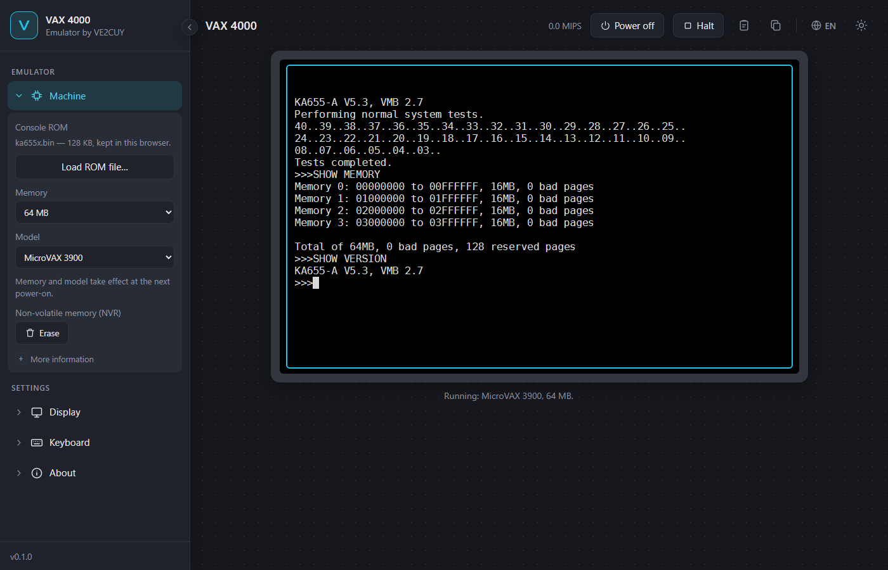

# Émulateur VAX 4000

Un émulateur VAX qui s'exécute dans votre fureteur, écrit en Rust et compilé en
WebAssembly. Le but : installer et faire tourner **OpenVMS VAX**, comme sur un VAX 4000
modèle 200.

**L'essayer : <https://ve2cuy.github.io/vax-emu/>** · [English version](README.md)



## État

- **Processeur** : jeu d'instructions complet du CVAX (entiers, virgule flottante F/D/G,
  chaînes, files, gestion de la mémoire, exceptions et interruptions). Il réussit le
  diagnostic DEC *Hardware Core Instruction* (EHKAA).
- **Machine** : KA655 (MicroVAX 3900 / VAXserver 3900) — mémoire jusqu'à 512 Mo, ligne
  série de la console, temporisateurs, horloge, adaptateur Qbus. Le microprogramme de la
  console fait ses autotests et donne l'invite `>>>`.
- **À venir** : disques MSCP (amorcer le CD d'OpenVMS, l'installer sur un disque gardé
  dans le fureteur), puis l'identité du VAX 4000-200 (KA660).

## Pour commencer

1. Téléchargez le ROM de la console du KA655,
   [`ka655x.bin`](https://github.com/simh/simh/raw/master/VAX/ka655x.bin), du projet
   [SIMH](https://github.com/simh/simh).
2. Ouvrez l'émulateur, puis **Machine › Charger un fichier ROM…** et choisissez
   `ka655x.bin`. Le ROM reste dans votre fureteur (il n'est jamais envoyé) et resservira à
   votre prochaine visite.
3. Les autotests défilent de 40 à 03, puis l'invite de la console `>>>` apparaît. Cliquez
   sur le terminal et tapez, par exemple :

```
>>> SHOW MEMORY
>>> SHOW VERSION
>>> HELP
```

Le bouton **Arrêt** (ou Ctrl+P, quand la console le permet) arrête le processeur et
revient à l'invite `>>>`, comme la touche BREAK d'un vrai terminal de console.

## Licence et remerciements

Licence Apache 2.0. Le processeur et la console sont une traduction en Rust du simulateur
VAX de [SIMH](https://github.com/simh/simh) de Robert M Supnik (licence de type MIT, voir
[NOTICE](NOTICE)). Terminal : [xterm.js](https://xtermjs.org/) (MIT).

Le microprogramme et les logiciels de DEC (ROM de la console, diagnostics, OpenVMS) sont
© Digital Equipment Corporation et ses successeurs; aucun ne fait partie de ce projet.
